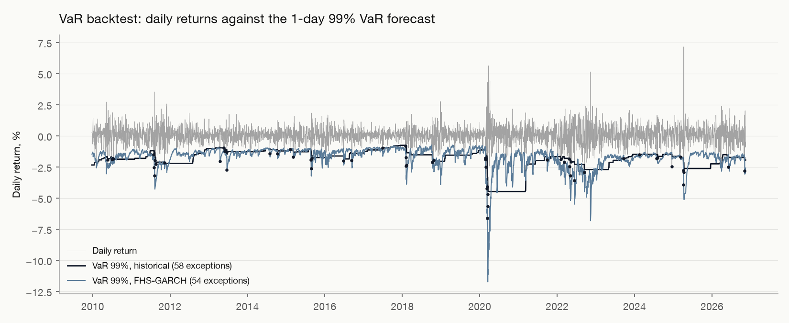

# Portfolio Risk Engine

[](https://github.com/Lupikkkk/portfolio-risk-engine/actions/workflows/tests.yml)

A Python engine that measures and validates the market risk of a multi-asset portfolio. It follows the workflow of a bank risk team or an asset manager's risk function:

1. **Measure.** One-day Value-at-Risk with five methods: historical simulation, parametric normal, parametric Student-t (maximum likelihood), Monte Carlo with multivariate t shocks, and **Filtered Historical Simulation on GARCH(1,1) and GJR-GARCH(1,1)**. Expected Shortfall at 97.5%, the FRTB standard.
2. **Validate.** Rolling out-of-sample backtests on a common period: Kupiec proportion-of-failures, Christoffersen independence and conditional coverage, the Basel traffic light, and the **Acerbi-Szekely Z2 backtest for Expected Shortfall**.
3. **Stress.** Replay of historical crises (GFC 2008, euro crisis 2011, COVID 2020, the 2022 rates shock, SVB 2023) and hypothetical shocks propagated to the other assets through regression betas.
4. **Attribute.** Euler decomposition of VaR into marginal and component VaR per asset.

The GARCH and GJR-GARCH models are implemented from scratch (likelihood, constraints, optimisation with scipy) and are tested by recovering known parameters from simulated data.



## The question the project answers

**Does a risk model that reacts to volatility beat plain historical simulation?**

Historical VaR weights the last 250 days equally, so it is slow to rise when a crisis starts and slow to fall afterwards. Its exceptions therefore arrive in clusters. A model can have the right number of exceptions over ten years and still fail when it matters. Filtered Historical Simulation fixes this: it divides returns by their GARCH volatility, takes the quantile of the standardised residuals (which keeps fat tails), and scales by tomorrow's volatility forecast.

`python main.py` puts both models through the same out-of-sample period and writes the verdict to [`reports/summary.md`](reports/summary.md): exception counts, p-values of the coverage and independence tests, the Basel zone and the ES backtest.

## Results

Portfolio: SPY 35%, TLT 25%, GLD 10%, EFA 15%, QQQ 15%. Daily Yahoo Finance prices, January 2007 to November 2026. The out-of-sample backtest runs from January 2010 (after the first 750-day GARCH window), 4,248 days in total, the same period for every method.

**99% VaR backtest** (42.5 exceptions expected)

| Method | Exceptions | Kupiec p | Independence p | Cond. coverage p |
|---|---:|---:|---:|---:|
| Historical simulation | 58 | 0.023 | 0.0001 | 0.0000 |
| Parametric normal | 88 | 0.000 | 0.0000 | 0.0000 |
| Parametric Student-t | 62 | 0.005 | 0.0000 | 0.0000 |
| FHS-GARCH | 54 | 0.088 | 0.005 | 0.005 |
| **FHS-GJR-GARCH** | **53** | **0.118** | **0.032** | **0.030** |

**97.5% Expected Shortfall backtest** (Acerbi-Szekely Z2, 0 for a correct model, reject below −0.7)

| Method | Z2 | Exceptions (106 expected) |
|---|---:|---:|
| Historical simulation | −0.35 | 131 |
| FHS-GARCH | −0.06 | 109 |
| FHS-GJR-GARCH | −0.07 | 110 |

**Verdict.** Volatility filtering works. Both FHS models pass the Kupiec test, and their ES is almost exactly right (Z2 ≈ 0, against −0.35 for historical simulation, which underestimates tail losses). The normal model fails badly: it produces twice the expected number of exceptions. Exception clustering is the harder problem. Plain GARCH(1,1) cuts it a lot (the independence p-value rises from 0.0001 to 0.005), but in March 2020 volatility jumped faster than the model could follow.

**Second step: asymmetric volatility.** In equity-heavy portfolios, falls raise volatility more than rallies of the same size (the leverage effect). GJR-GARCH adds a term γ·ε² that applies only after negative returns. On the full sample the asymmetry is strong. The estimates are α = 0.007 and γ = 0.142: almost all the volatility response comes from down days. The likelihood-ratio statistic against plain GARCH is 136 (5% critical value 3.84), and AIC falls by 134. Out of sample, FHS-GJR has the best coverage of all methods (Kupiec p = 0.12), and the independence p-value rises again, from 0.005 to 0.032. It is close to the 5% line but still below it. Some clustering remains. The likely causes are a single-asset volatility model and constant correlations, which a multivariate model (DCC) would address.

Other numbers from the same run: GARCH persistence is 0.984 (volatility shocks have a half-life of 43 days). SPY, QQQ and EFA account for 95% of parametric 99% VaR, while TLT, with a 25% weight, adds only 0.5% because of its low correlation with equities. The worst historical scenario is the 2008 Lehman collapse (−27%), closely followed by the 2022 rates shock (−26%), when bonds fell together with equities. Full output: [`reports/summary.md`](reports/summary.md).

## Quick start

```bash
pip install -r requirements.txt

# Full report on real market data (downloads prices from Yahoo Finance)
python main.py --tickers SPY TLT GLD EFA QQQ --weights 0.35 0.25 0.10 0.15 0.15 --start 2007-01-01

python main.py --demo      # offline, simulated fat-tailed prices with volatility clustering
streamlit run app.py       # interactive dashboard
pytest -q                  # 20 tests
```

## Project structure

```
risk_engine/
  data.py        price loading (yfinance / CSV) and a synthetic simulator
  portfolio.py   portfolio returns, performance statistics, Euler risk decomposition
  var.py         historical, parametric (normal / t), Monte Carlo VaR; Expected Shortfall
  garch.py       EWMA, GARCH(1,1) and GJR-GARCH(1,1) by maximum likelihood, Filtered Historical Simulation
  backtest.py    rolling forecasts, Kupiec, Christoffersen, conditional coverage, Basel zones, ES Z2 test
  stress.py      historical scenario replay and beta-propagated hypothetical shocks
main.py          command-line report, charts and reports/summary.md
app.py           Streamlit dashboard
tests/           formula checks, parameter recovery, no-look-ahead check, power of the tests
```


## Methodology

| Component | Method |
|---|---|
| Historical VaR | Empirical (1 − α) quantile of portfolio returns |
| Parametric VaR | Normal: μ + z·σ. Student-t: degrees of freedom, location and scale fitted by maximum likelihood |
| Student-t ES | ES = −μ + s · f(q)/(1 − α) · (ν + q²)/(ν − 1), with q = t_ν⁻¹(1 − α) |
| Monte Carlo VaR | 100k draws from a multivariate t (df = 5) with the sample covariance (Cholesky) |
| GARCH(1,1) | σ²ₜ = ω + α·ε²ₜ₋₁ + β·σ²ₜ₋₁, Gaussian quasi-maximum likelihood, α + β < 1 |
| GJR-GARCH(1,1) | σ²ₜ = ω + (α + γ·1[εₜ₋₁ < 0])·ε²ₜ₋₁ + β·σ²ₜ₋₁, α + γ/2 + β < 1; compared with GARCH by LR test and AIC/BIC |
| FHS VaR / ES | VaRₜ₊₁ = −(μ + σₜ₊₁ · q₁₋α(z)), where z are GARCH-standardised residuals |
| Kupiec test | LR = −2·ln[L(p)/L(p̂)] ~ χ²(1), H0: exception rate = 1 − α |
| Christoffersen | First-order Markov LR test of independence; conditional coverage LR ~ χ²(2) |
| ES backtest | Acerbi-Szekely Z2 = Σ rₜIₜ / (T(1 − α)ESₜ) + 1, expected value 0, reject below −0.7 |
| Component VaR | CVaRᵢ = wᵢ · z · (Σw)ᵢ / σₚ; components sum exactly to total VaR |
| Hypothetical shocks | E[r | r_driver = s] = β·s, with β = Σ_yx Σ_xx⁻¹ |

Every forecast uses only data available before the forecast day. GARCH parameters are re-estimated every 20 days on a 750-day window. A unit test checks that there is no look-ahead.

## Limitations

- Weights are constant (rebalanced daily). Options and other non-linear positions would need full revaluation.
- GARCH and GJR-GARCH are fitted to portfolio returns (univariate). A multivariate model (DCC) would let correlations move in a crisis.
- Some exception clustering remains even with GJR-GARCH (independence p = 0.03), concentrated in March 2020.
- The −0.7 threshold for Z2 is the approximation reported by Acerbi and Szekely. A simulated critical value would be more exact.

---
Author: Artem Lubkivskyi, BSc Economics and Business, Stockholm School of Economics in Riga
