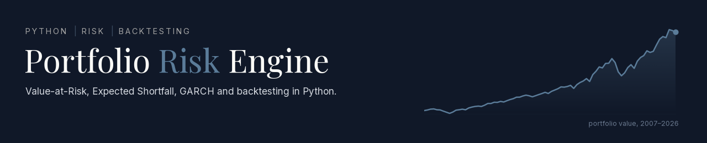
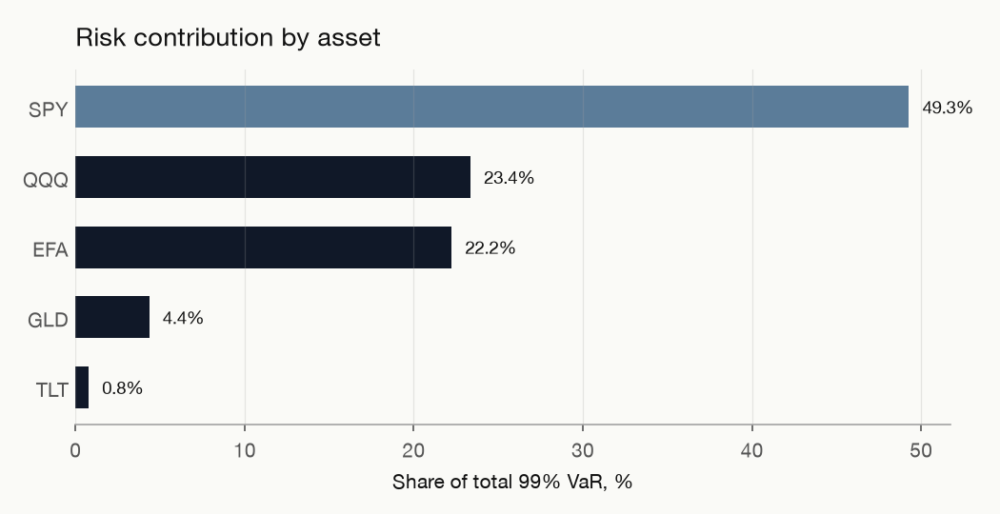

# Portfolio Risk Engine

[](https://github.com/Lupikkkk/portfolio-risk-engine/actions/workflows/tests.yml)

A Python engine that measures and validates the market risk of a multi-asset portfolio. It follows the workflow of a bank risk team or an asset manager's risk function:

1. **Measure.** One-day Value-at-Risk with five methods: historical simulation, parametric normal, parametric Student-t (maximum likelihood), Monte Carlo with multivariate t shocks, and **Filtered Historical Simulation on GARCH(1,1) and GJR-GARCH(1,1)**. Expected Shortfall at 97.5%, the FRTB standard.
2. **Validate.** Rolling out-of-sample backtests on a common period: Kupiec proportion-of-failures, Christoffersen independence and conditional coverage, the Basel traffic light, and the **Acerbi-Szekely Z2 backtest for Expected Shortfall**.
3. **Stress.** Replay of historical crises (GFC 2008, euro crisis 2011, COVID 2020, the 2022 rates shock, SVB 2023) and hypothetical shocks propagated to the other assets through regression betas.
4. **Attribute.** Euler decomposition of VaR into marginal and component VaR per asset.

The GARCH and GJR-GARCH models are implemented from scratch (likelihood, constraints, optimisation with scipy) and are tested by recovering known parameters from simulated data.


## The question the project answers

**Does a risk model that reacts to volatility beat plain historical simulation?**

Historical VaR weights the last 250 days equally, so it is slow to rise when a crisis starts and slow to fall afterwards. Its exceptions therefore arrive in clusters. A model can have the right number of exceptions over ten years and still fail when it matters. Filtered Historical Simulation is designed to fix this: it divides returns by their GARCH volatility, takes the quantile of the standardised residuals (which keeps fat tails), and scales by tomorrow's volatility forecast.

`python main.py` puts both models through the same out-of-sample period and writes the verdict to [`reports/summary.md`](reports/summary.md): exception counts, p-values of the coverage and independence tests, the Basel zone and the ES backtest.

## Results

Portfolio: SPY 35%, TLT 25%, GLD 10%, EFA 15%, QQQ 15%. Daily Yahoo Finance prices, 3 January 2005 to 12 November 2026 (GLD starts trading in November 2004). The out-of-sample backtest starts on 27 December 2007, after the first 750-day GARCH window, so **the 2008 crisis is inside the test**. It covers 4,750 days, the same period for every method. Every number below is in [`reports/`](reports/): the tables in [`summary.md`](reports/summary.md) and [`backtest.csv`](reports/backtest.csv), every exception date in [`exceptions.csv`](reports/exceptions.csv).

**99% VaR backtest** (47.5 exceptions expected)

| Method | Exceptions | of which in 2008 | Kupiec p | Independence p | Cond. coverage p |
|---|---:|---:|---:|---:|---:|
| Historical simulation | 71 | 13 | 0.001 | 0.0001 | 0.000 |
| Parametric normal | 104 | 16 | 0.000 | 0.0000 | 0.000 |
| Parametric Student-t | 74 | 12 | 0.000 | 0.0000 | 0.000 |
| FHS-GARCH | 59 | 4 | **0.106** | 0.0065 | 0.007 |
| FHS-GJR-GARCH | 63 | 6 | 0.031 | **0.062** | 0.017 |

**97.5% Expected Shortfall backtest** (Acerbi-Szekely Z2, 0 for a correct model, reject below −0.7)

| Method | Z2 | Exceptions (119 expected) |
|---|---:|---:|
| Historical simulation | −0.43 | 155 |
| FHS-GARCH | −0.11 | 129 |
| FHS-GJR-GARCH | −0.10 | 127 |

**Verdict.** Volatility filtering clearly beats historical simulation, and 2008 shows it most clearly. Historical VaR had 13 exceptions that year, five times the expected 2.5, because its 250-day window was still full of calm 2007 days. FHS-GARCH had 4. Over the whole period the FHS models cut exceptions from 71 to about 60, and they bring Z2 from −0.43 to −0.10: historical simulation understates the size of tail losses, FHS gets it nearly right. The normal model fails badly, with more than twice the expected number of exceptions.

No model passes every test, and the two GARCH variants fail in opposite ways:

- **FHS-GARCH** has the right number of exceptions (Kupiec p = 0.11), but they still cluster (independence p = 0.007). In March 2020 volatility jumped faster than the model could follow.
- **FHS-GJR-GARCH** fixes the clustering (independence p = 0.06). In equity-heavy portfolios falls raise volatility more than rallies of the same size (the leverage effect), and GJR adds a term γ·ε² that applies only after negative returns. The asymmetry is strong. The estimates are α = 0.006 and γ = 0.141, so almost all the volatility response comes from down days. The likelihood-ratio statistic against plain GARCH is 152 (5% critical value 3.84). The cost is too many exceptions overall (63, Kupiec p = 0.03). After calm stretches GJR lets VaR fall further, so sudden drops from low volatility catch it out.

Both results point to the same next step. A univariate model on portfolio returns cannot see correlations move, and a multivariate model (DCC) is the natural extension.

**Basel traffic light.** Over the last 250 days (14 November 2025 to 12 November 2026) both FHS models are in the yellow zone (6 and 5 exceptions), while historical simulation is in the green zone (2). This does not contradict the long-run result. Two of the days, 5 June and 5 November 2026, broke every model. The others broke the FHS models but not historical simulation: 30 January, 3 March, 20 March and 30 October for FHS-GARCH. FHS VaR follows recent volatility, so after quiet weeks it sits low, and a sudden drop breaks it. Historical VaR, on the other hand, still had the −3.93% day of 4 April 2025 in its 250-day window until 6 April 2026, which kept it high through the first months of a quiet year. Under Basel rules a yellow zone raises the capital multiplier. A bank would accept that cost only because the green model fails in a real crisis, as 2008 shows.

**Today's VaR** (as of 12 November 2026). The conditional 99% VaR from FHS-GARCH is 30,900 per million, 45% above historical VaR (21,300). The reason is recent volatility. Realised volatility over the last 20 days is 17.0% annualised, against 12.3% over the last 250 days, after moves of −1.52% (30 October), +1.68% (4 November), −2.81% (5 November) and +2.01% (9 November). GARCH puts tomorrow's volatility at 18.1%, while historical VaR still averages a year of mostly calm days. If the market stays calm, the gap closes within weeks (the half-life of a volatility shock is about 40 days).

Other numbers from the same run: SPY, QQQ and EFA account for 95% of parametric 99% VaR, while TLT, with a 25% weight, adds less than 1% because of its low correlation with equities. The worst historical scenario is the 2008 Lehman collapse (−27%), closely followed by the 2022 rates shock (−26%), when bonds fell together with equities. Full output: [`reports/summary.md`](reports/summary.md).



## Quick start

```bash
pip install -r requirements.txt

# Full report on real market data (downloads prices from Yahoo Finance)
# --end fixes the last day, so the run reproduces the numbers above; omit it for the latest data
python main.py --tickers SPY TLT GLD EFA QQQ --weights 0.35 0.25 0.10 0.15 0.15 --start 2005-01-01 --end 2026-11-12

python main.py --demo      # offline, simulated fat-tailed prices with volatility clustering
streamlit run app.py       # interactive dashboard
pytest -q                  # 20 tests
```

## Project structure

```
risk_engine/
  data.py        price loading (yfinance / CSV) and a synthetic simulator
  portfolio.py   portfolio returns, performance statistics, Euler risk decomposition
  var.py         historical, parametric (normal / t), Monte Carlo VaR; Expected Shortfall
  garch.py       EWMA, GARCH(1,1) and GJR-GARCH(1,1) by maximum likelihood, Filtered Historical Simulation
  backtest.py    rolling forecasts, Kupiec, Christoffersen, conditional coverage, Basel zones, ES Z2 test
  stress.py      historical scenario replay and beta-propagated hypothetical shocks
main.py          command-line report, charts and reports/summary.md
app.py           Streamlit dashboard
tests/           formula checks, parameter recovery, no-look-ahead check, power of the tests
```

## Methodology

| Component | Method |
|---|---|
| Historical VaR | Empirical (1 − α) quantile of portfolio returns |
| Parametric VaR | Normal: μ + z·σ. Student-t: degrees of freedom, location and scale fitted by maximum likelihood |
| Student-t ES | ES = −μ + s · f(q)/(1 − α) · (ν + q²)/(ν − 1), with q = t_ν⁻¹(1 − α) |
| Monte Carlo VaR | 100k draws from a multivariate t (df = 5) with the sample covariance (Cholesky) |
| GARCH(1,1) | σ²ₜ = ω + α·ε²ₜ₋₁ + β·σ²ₜ₋₁, Gaussian quasi-maximum likelihood, α + β < 1 |
| GJR-GARCH(1,1) | σ²ₜ = ω + (α + γ·1[εₜ₋₁ < 0])·ε²ₜ₋₁ + β·σ²ₜ₋₁, α + γ/2 + β < 1; compared with GARCH by LR test and AIC/BIC |
| FHS VaR / ES | VaRₜ₊₁ = −(μ + σₜ₊₁ · q₁₋α(z)), where z are GARCH-standardised residuals |
| Kupiec test | LR = −2·ln[L(p)/L(p̂)] ~ χ²(1), H0: exception rate = 1 − α |
| Christoffersen | First-order Markov LR test of independence; conditional coverage LR ~ χ²(2) |
| ES backtest | Acerbi-Szekely Z2 = Σ rₜIₜ / (T(1 − α)ESₜ) + 1, expected value 0, reject below −0.7 |
| Component VaR | CVaRᵢ = wᵢ · z · (Σw)ᵢ / σₚ; components sum exactly to total VaR |
| Hypothetical shocks | E[r | r_driver = s] = β·s, with β = Σ_yx Σ_xx⁻¹ |

Every forecast uses only data available before the forecast day. GARCH parameters are re-estimated every 20 days on a 750-day window. A unit test checks that there is no look-ahead.

## Limitations

- Weights are constant (rebalanced daily). Options and other non-linear positions would need full revaluation.
- GARCH and GJR-GARCH are fitted to portfolio returns (univariate). A multivariate model (DCC) would let correlations move in a crisis.
- No model passes all three coverage tests: FHS-GARCH still clusters exceptions, and FHS-GJR-GARCH has too many of them.
- Yahoo Finance recomputes adjusted prices on every download, so a rerun can move currency figures by a few units per million. Exception counts, dates and test results do not change.
- The −0.7 threshold for Z2 is the approximation reported by Acerbi and Szekely. A simulated critical value would be more exact.

---
Author: Artem Lubkivskyi, BSc Economics and Business, Stockholm School of Economics in Riga
